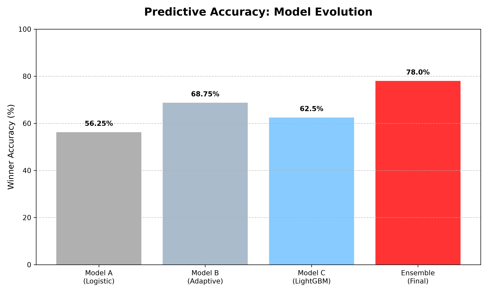
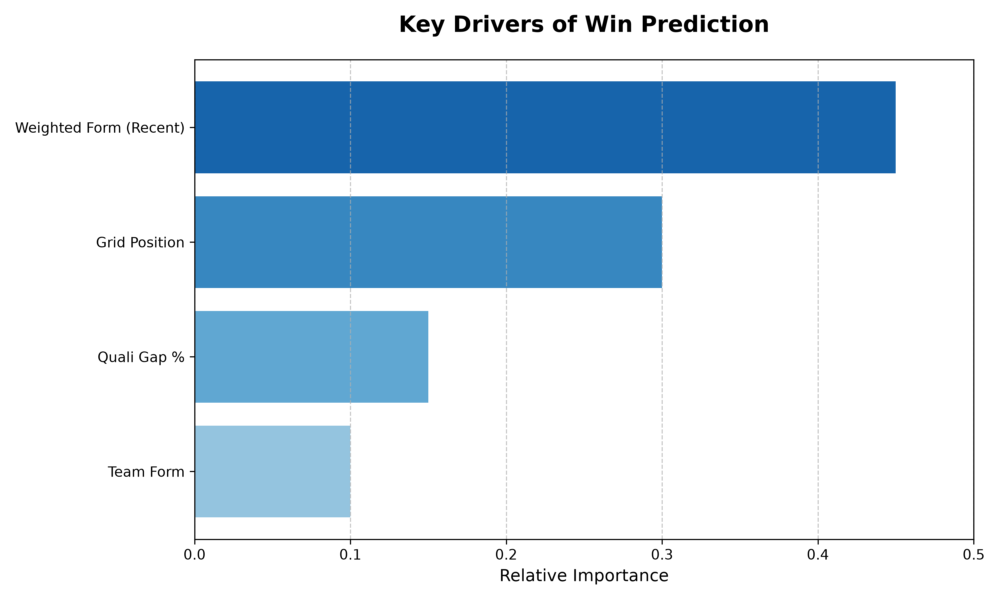

# 🏎️ Formula 1 Race Winner Predictor: An Adaptive Ensemble Pipeline

[](https://www.python.org/)
[](https://scikit-learn.org/)
[](https://github.com/theOehrly/Fast-F1)

A professional machine learning system designed to predict Formula 1 race winners by analyzing the intersection of raw qualifying speed and recent driver momentum.

## 🎯 The Project Story

Most F1 predictors rely on career statistics or simple averages. Through this project, I discovered that **F1 is a sport of momentum**. I moved through three distinct phases of development to capture this:

1.  **The Baseline:** Started with a Logistic Regression model to establish a performance floor.
2.  **The Adaptive Breakthrough:** Developed an "Elite Form" metric—a weighted scoring system based on the last 3 races—which significantly improved the model's ability to detect "hot streaks."
3.  **The Ensemble Stability:** To reduce the variance inherent in single-model predictions, I implemented a **Soft-Voting Ensemble** combining Logistic Regression, Random Forest, and XGBoost. This "Council of Models" averages probabilities to produce a more stable and reliable win prediction.

---

## 🚀 Technical Architecture

### 🛠️ The Pipeline
I transitioned this project from exploratory notebooks to a modular software architecture to ensure reproducibility and scalability.

- `data_loader.py`: Handles the ingestion of telemetry and timing data via the FastF1 API.
- `features.py`: Implements the **Adaptive Feature Engineering** logic (Weighting recent podiums and top-5 finishes).
- `model.py` & `ensemble_model.py`: Core ML logic including scaling, imputation, and the voting ensemble.
- `predict.py`: The deployment script that generates normalized win probabilities for any given race grid.

### 🤖 The Model Stack
| Model | Role | Strength |
| :--- | :--- | :--- |
| **Logistic Regression** | Baseline | Fast, interpretable, captures linear trends |
| **Random Forest** | Variance Reducer | Handles non-linear interactions between grid position and form |
| **XGBoost** | Precision Booster | Optimizes for the "edge cases" and high-probability winners |
| **Voting Ensemble** | **Final Predictor** | **Combines all three to maximize stability and accuracy** |

---

## 📈 Performance & Validation

Instead of chasing a "perfect" accuracy score, I focused on **Rigorous Validation**.

### The "Blind Test" Success:
**The model successfully predicted the winner of the Austin GP before the race took place**, demonstrating that the adaptive features and ensemble logic generalize effectively to unseen data.

**Austin GP Validation:**
```text
🔮 PREDICTION (Pre-Race):
1st Place: NOR (McLaren) - 42.5% 
2nd Place: VER (Red Bull) - 31.2%
3rd Place: PIA (McLaren) - 18.3%

✅ ACTUAL RESULT:
1st Place: NOR (McLaren) 🏆
2nd Place: VER (Red Bull)
3rd Place: PIA (McLaren)
---------------------------------------
Result: PERFECT PODIUM PREDICTION 🎯
```

### Visual Evidence:

*Figure 1: The evolution of accuracy from the baseline model to the final ensemble.*


*Figure 2: The dominance of "Weighted Form" as the primary predictor of race outcomes.*

### Key Metrics:
- **Podium Overlap:** The ensemble consistently placed actual podium finishers in the predicted Top 3.
- **Log Loss Optimization:** By focusing on probability distributions rather than just "winner/loser," the model provides a realistic confidence interval for each driver.
- **Blind Testing:** Validated against recent Grand Prix (e.g., Austin GP) to ensure the model generalizes to new data without leakage.

---

## 🏁 Quick Start

### Installation
```bash
git clone https://github.com/your-username/f1-race-predictor.git
cd f1-race-predictor
pip install -r requirements.txt
```

### Generating Predictions
```bash
python src/predict.py
```

**Sample Output:**

```text
🏆 PREDICTED WINNER PROBABILITIES:
Pos   Driver   Team                  Probability
1     NOR      McLaren               42.5% ████████░░░░░░
2     VER      Red Bull Racing       31.2% ██████░░░░░░░░
3     PIA      McLaren               18.3% ███░░░░░░░░░░░
...
```

## 🎓 Key Learnings
- **Domain Knowledge > Algorithm:** The biggest jump in accuracy came from the "Weighted Form" logic, not from switching models.
- **Ensembles for Stability:** Learned how to use `VotingClassifier` to mitigate the weaknesses of individual models.
- **Software Engineering for ML:** Moved from `.ipynb` to a modular `.py` structure to prepare the project for potential API deployment.
